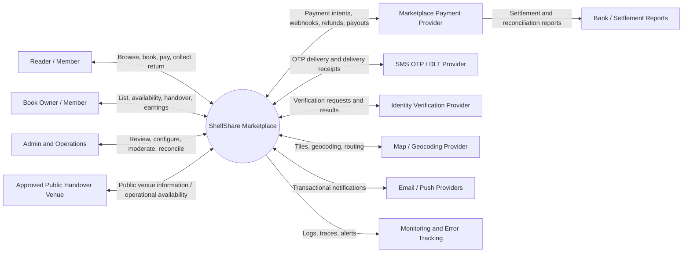
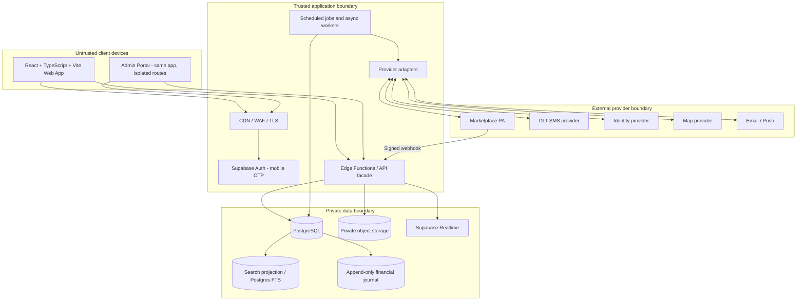
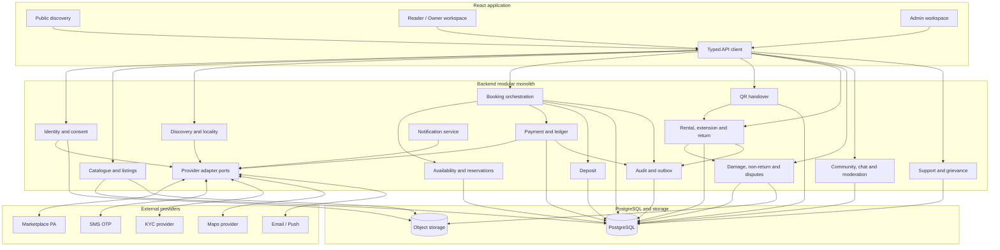
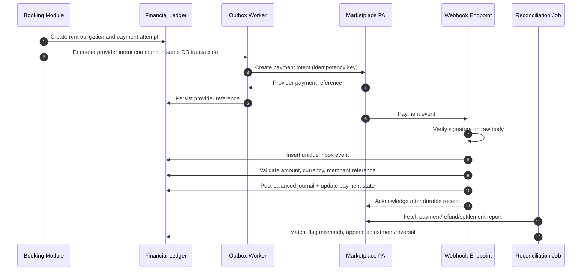
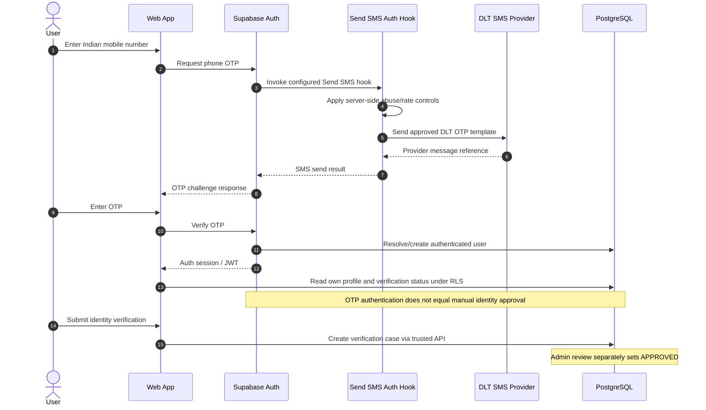

# ShelfShare — Complete Technical Architecture

**Version:** 1.0  
**Status:** Architecture proposal; vendor selection and legal/provider gates remain open  
**Product basis:** ShelfShare PRD v1.0, Project Master Context and business-rule/state-machine specifications  
**Markets:** Hyderabad and Bengaluru; locality-based; same-city rentals only  
**Runtime conventions:** INR integer paise; UTC persistence; Asia/Kolkata display

## 1. Executive architecture decision

Build ShelfShare as a **modular monolith with asynchronous workers**, not a microservice fleet. Use React + TypeScript + Vite for the responsive web application and Supabase-managed PostgreSQL, Auth, Storage and Realtime as the initial managed backend platform. Put sensitive business operations behind server-side Edge Functions and PostgreSQL functions/RPCs. Keep provider adapters behind internal interfaces. Use PostgreSQL as the source of truth for transactional state, reservation safety and financial ledgers.

This architecture fits an early two-city marketplace because booking, payment, deposit, collection and return have strong transactional coupling. A modular monolith reduces deployment and operational complexity while preserving domain boundaries. Split components into independent services only when measured scale, team ownership, regulatory boundary or availability needs justify it.

**Important qualification:** Supabase is a platform, not a substitute for domain architecture. RLS is defence-in-depth, not the only authorization layer. Critical state transitions must be server-authorised and transactionally enforced.

## 2. System architecture

### 2.1 Logical architecture

- **Experience layer:** public discovery, authenticated Reader/Owner app, Admin operations portal.
- **API/application layer:** authentication callbacks, domain commands, query endpoints, webhooks, scheduled jobs and provider adapters.
- **Domain modules:** identity, profiles/consents, catalogue/listings, discovery, inventory, booking, payment, deposit, handover, rental, extension, return, claims/disputes, payout, exchange, referral, community/moderation, support and notifications.
- **Data layer:** PostgreSQL transactional database, append-only audit/event records, object storage, search indexes/materialised views and analytics export.
- **Integration layer:** payment aggregator/PA product, SMS/DLT provider, identity verification provider, maps/geocoding, email/push providers and monitoring.
- **Operations layer:** admin RBAC, financial reconciliation, moderation queues, support console, alerting, backup/restore and release management.

### 2.2 System context diagram



### 2.3 Container diagram



## 3. Frontend architecture

### 3.1 Application structure

Use one React application with route-level modules and separate layouts:
- Public: landing, discovery, book/copy detail, city/locality pages, help and legal documents.
- Member: onboarding, verification, reader dashboard, owner dashboard, listing editor, availability calendar, booking detail, chat, payment status, handover/return QR, disputes, wishlist and profile.
- Admin: verification queue, listing moderation, user controls, booking operations, finance/reconciliation, deposit/claims, disputes, support, community moderation, configuration and audit viewer.

Suggested source layout:

```text
src/
  app/                 # router, providers, guards, error boundaries
  shared/              # design system, primitives, API client, schemas
  features/
    auth/
    verification/
    catalogue/
    listings/
    discovery/
    availability/
    bookings/
    payments/
    deposits/
    handover/
    rentals/
    extensions/
    returns/
    disputes/
    exchanges/
    referrals/
    community/
    chat/
    notifications/
    support/
    admin/
  integrations/        # typed client wrappers only; no secrets
  generated/           # generated database types
```

### 3.2 Frontend technology assessment

- React + TypeScript + Vite: suitable. Keep.
- Tailwind CSS + shadcn/ui: suitable for consistent responsive interface and accessible primitives; enforce accessibility tests and design tokens.
- React Router: suitable for route boundaries and protected layouts.
- TanStack Query: suitable for server-state caching, invalidation and optimistic UI only for noncritical actions.
- React Hook Form + Zod: suitable for complex onboarding/listing/claim forms.
- Add a small typed API layer generated from database/API contracts; do not let components call privileged provider APIs.
- Add Playwright for browser E2E, Vitest + Testing Library for component/unit tests, axe checks for accessibility.
- Use a QR library only for display/scanning. QR is a transport for a short-lived server token, not proof by itself.

### 3.3 Frontend security

- No Supabase service-role key or provider secret in browser bundle.
- RLS and server authorization for every private query/mutation.
- Avoid storing identity documents or payment data in browser local storage.
- Use secure session handling supported by Auth SDK; apply CSP, HSTS, secure headers and dependency scanning at hosting edge.
- Admin routes require server-issued permission checks; hiding a route is not access control.
- Public map results must never expose owner residential address or exact sensitive coordinates.
- Treat realtime payloads as untrusted; re-fetch authoritative state after sensitive notifications.

## 4. Backend architecture

### 4.1 Modular monolith boundaries

Implement each domain as a module with:
- command handlers (state-changing operations);
- query handlers (read models);
- policy/validation functions;
- repository/data access;
- event definitions;
- adapter ports;
- tests.

Modules:
1. Identity & Access.
2. User Profile & Consent.
3. Catalogue & Metadata.
4. Listing & Copy Management.
5. Discovery & Location.
6. Availability & Reservations.
7. Booking Orchestration.
8. Payment & Financial Ledger.
9. Deposit.
10. Handover & QR.
11. Rental & Extension.
12. Return & Condition Evidence.
13. Damage & Non-return Claims.
14. Dispute & Appeals.
15. Owner Settlement/Payout.
16. Exchange.
17. Referral & Promotions.
18. Community & Moderation.
19. Chat.
20. Notification.
21. Support/Grievance.
22. Admin Configuration & Audit.

### 4.2 Runtime components

- **Supabase Auth:** OTP authentication/session issuance.
- **Edge Functions:** authenticated application API, payment/provider webhook endpoints, signed upload issuance, scheduled commands where appropriate.
- **PostgreSQL functions/RPC:** atomic booking reservation, extension reservation update, handover completion, ledger posting and privileged transitions. Functions must validate caller/service role and enforce invariants.
- **Database triggers:** only for deterministic integrity/audit/outbox operations; avoid business workflows hidden in complex triggers.
- **Async worker/scheduler:** webhook retries, expiry, reminders, reconciliation, notification dispatch, payout status polling and analytics export.
- **Transactional outbox/inbox:** ensure state and event/command are committed together.
- **Provider adapters:** isolate vendor-specific payloads, signatures, status mapping and retry rules.

### 4.3 API design

Use versioned REST-style endpoints or typed Edge Function commands. Examples:
- `POST /v1/bookings`
- `POST /v1/bookings/{id}/cancel`
- `POST /v1/bookings/{id}/extensions`
- `POST /v1/handovers/{id}/owner-confirmation`
- `POST /v1/handovers/{id}/reader-confirmation`
- `POST /v1/returns/{id}/confirm`
- `POST /v1/disputes`
- `POST /v1/webhooks/payments/{provider}`
- `GET /v1/bookings/{id}`

Every command has an idempotency key where retries can create side effects. API responses include resource state/version, not provider secrets. Return structured error codes such as `COPY_UNAVAILABLE`, `IDENTITY_NOT_APPROVED`, `CITY_MISMATCH`, `PAYMENT_PENDING`, `TOKEN_EXPIRED`.

### 4.4 Asynchronous processing

Use database-backed outbox + worker polling initially. Queue implementation can evolve to a managed queue when volume/latency needs justify it. Retry transient errors with exponential backoff and jitter; dead-letter after configured attempts. Business state remains in PostgreSQL; queue messages are delivery hints, not source of truth.

## 5. Database architecture

### 5.1 PostgreSQL is the transactional source of truth

Use managed Supabase PostgreSQL with:
- UUID primary keys.
- `timestamptz` in UTC.
- INR amounts as `bigint` paise.
- `numeric` only where exact decimal quantities are required; never float for money.
- Foreign keys, check constraints, unique constraints and exclusion constraints.
- Explicit version columns for aggregate concurrency.
- Soft deletion only where business/legal semantics allow; preserve financial/audit evidence.
- Migrations in Git and applied through CI to staging before production.

### 5.2 Logical schema domains

| Domain | Core tables (indicative) |
|---|---|
| Identity | `profiles`, `verification_cases`, `verification_documents`, `verification_reviews`, `consents`, `legal_document_versions` |
| Geography | `cities`, `localities`, `handover_points`, `handover_point_hours` |
| Catalogue | `books`, `book_editions`, `physical_book_copies`, `copy_photos`, `copy_condition_reports` |
| Listings | `listings`, `listing_reviews`, `listing_price_versions` |
| Availability | `copy_reservations`, `copy_blocks`, `availability_rules` |
| Booking | `bookings`, `booking_policy_snapshots`, `booking_participants`, `booking_events` |
| Handover | `handover_sessions`, `handover_tokens`, `handover_confirmations` |
| Rental | `rentals`, `rental_extensions`, `rental_reminders` |
| Payments | `payment_intents`, `payment_attempts`, `provider_webhook_inbox`, `refunds`, `payouts`, `financial_journal_entries` |
| Deposit | `deposit_obligations`, `deposit_provider_operations`, `deposit_claim_allocations` |
| Claims | `damage_claims`, `claim_evidence`, `claim_assessments`, `claim_appeals` |
| Disputes | `disputes`, `dispute_messages`, `dispute_evidence`, `dispute_decisions` |
| Engagement | `wishlists`, `waitlists`, `reviews`, `referrals`, `referral_rewards`, `exchanges` |
| Community | `posts`, `comments`, `reports`, `moderation_cases`, `blocks`, `mutes` |
| Communication | `conversations`, `conversation_members`, `messages`, `notifications`, `notification_preferences` |
| Operations | `support_tickets`, `admin_roles`, `admin_permissions`, `audit_events`, `outbox_events`, `job_runs` |

### 5.3 Critical constraints

- Unique mobile number (normalised E.164).
- Unique physical copy ID and owner association.
- Unique provider event ID per provider.
- Unique merchant reference/idempotency key for money operations.
- One successful collection per booking; one return closure per rental.
- Reviews reference completed rental and eligible participant.
- Exchange requires distinct verified participants and mutually accepted immutable offer version.
- Use PostgreSQL GiST exclusion constraint (`btree_gist`) over `(copy_id, reserved_period)` for live reservation statuses `HELD`, `CONFIRMED`, `ACTIVE`, `RETURN_PENDING`.
- Use half-open intervals `[start,end)` and include configured buffer in reserved range.
- Extension updates booking due date and reservation interval in one transaction.
- Unique/partial indexes for active state queries and scheduled jobs.

### 5.4 RLS and authorization

Enable RLS on all exposed tables. Default deny.
- Members may read/update only their own profile fields allowed by policy.
- Identity evidence is not directly readable from client; signed short-lived access mediated by authorised backend/admin permission.
- Owners may manage only their own copies/listings.
- Readers and Owners see booking records only as participants.
- Chat members access only their conversation.
- Public discovery uses a curated view exposing safe fields, not base profile/copy tables.
- Admin access is permission-scoped and preferably mediated by server functions; do not grant broad service-role credentials to the admin browser.
- Financial ledger writes are server-only; user-facing reads are filtered projections.

## 6. Authentication architecture

- Indian mobile OTP is the login/registration factor; no email OTP.
- Supabase Auth phone OTP can be evaluated as the identity/session provider, but production use depends on supported SMS integration, rate limits, template/DLT compatibility, deliverability, regional availability and commercial terms.
- SMS OTP provider is behind `SmsOtpProvider`; if Supabase Auth's supported custom SMS hook/flow meets requirements, use it. Otherwise use a custom OTP orchestration service with cryptographically secure OTP generation, hashed OTP storage, expiry, attempt caps, resend cooldown and one-time consumption.
- Do not maintain a second independent session system unless required; bind verified phone identity to Supabase user ID.
- OTP is not identity verification. Identity approval is a separate manual workflow.
- Session refresh/revocation, device/session visibility, account recovery and mobile number change with re-verification.
- Rate limit by phone, IP, device/risk bucket and country code; protect enumeration and SMS pumping.
- Admin accounts require stronger authentication and least privilege; exact MFA options must be verified with chosen auth provider.
- Registration captures first-use profile photo through live camera flow; accessible support fallback is a product decision, not gallery upload.

## 7. Identity verification architecture

Provider-independent `IdentityVerificationProvider` interface:
- `createSession(subject, purpose, documentTypes, callbackUrl)`
- `submitEvidence(sessionId, encryptedEvidenceReference)`
- `getVerificationResult(providerReference)`
- `cancelSession(providerReference)`
- `verifyWebhook(rawBody, headers)`
- `mapResult(providerPayload)`

Use provider-assisted document authenticity/field extraction only as evidence; the business state remains manual Admin review. Keep provider result separate from final `APPROVED`. Collect Passport preference, PAN only if no Passport, Driving Licence only if neither; address proof must be a separately decided requirement. Age 18+ check must be explicit.

Store raw documents in private storage with narrow access, encryption, malware scanning, retention/deletion policy and access audit. Avoid sending unnecessary profile, location or rental data to KYC provider. Provider selection requires India coverage, supported document types, consent/notice, data residency/subprocessors, security certifications, deletion SLA, pricing and API/webhook quality review.

## 8. Payment architecture

### 8.1 Design

Provider-independent `MarketplacePaymentProvider`:
- `createPaymentIntent`
- `fetchPaymentStatus`
- `capturePayment` (only if provider flow requires)
- `createRefund`
- `fetchRefundStatus`
- `createOwnerAccount/onboardSubMerchant`
- `createPayout/settlementInstruction`
- `fetchPayoutStatus`
- `verifyWebhook`
- `fetchSettlementReport`

The adapter maps provider-specific statuses to internal payment states. Never expose provider SDK secret to frontend. Payment events enter webhook inbox, are signature-verified, deduplicated and transactionally posted to ledger. Reconcile provider collection/refund/payout reports daily.

### 8.2 Marketplace settlement

The selected provider must confirm in writing:
- platform/marketplace eligibility and underwriting;
- sub-merchant/owner onboarding and KYC;
- split settlement and commission handling;
- delayed settlement/hold/reserve capabilities;
- refunds and partial refunds;
- chargeback evidence and dispute process;
- payout status and reconciliation reports;
- deposit custody/hold/release if proposed;
- support for Indian entities and the intended business model.

Razorpay Route and Cashfree Easy Split are candidates for evaluation, not selected vendors. Do not assume either offers a legally suitable deposit escrow. Obtain commercial and legal confirmation before integration.

## 9. Deposit architecture

Deposit subsystem is feature-flagged OFF until legal opinion and provider written approval. A database field does not represent custody. No informal escrow, platform pooled balance or unregulated wallet.

Keep deposit aggregate and provider operations separate from rent/commission. Model collection, provider-held status, release, refund, claim hold and proportional application as state machine. If no approved custody/hold product is available, disable deposit collection and define a safe launch alternative with counsel; do not implement a workaround.

## 10. SMS architecture

Provider-independent `SmsOtpProvider`:
- `sendOtp(destination, templateId, variables, idempotencyKey)`
- `getDeliveryStatus(providerMessageId)`
- `verifyWebhook(rawBody, headers)`
- `healthCheck()`

Keep OTP content/templates and transactional notification templates separate. Indian DLT registration, sender IDs, template approvals, consent classification and TRAI compliance must be validated with provider and counsel. Candidate providers can include MSG91, Gupshup or Exotel subject to current DLT, route, support, pricing and deliverability verification. SMS is not the sole source of truth; delivery receipts do not authenticate the user.

## 11. Maps and locality architecture

Use MapLibre GL JS as client renderer to avoid hard coupling to a single map vendor. Use provider abstraction for geocoding, autocomplete, directions and tile source. Evaluate Mappls, Google Maps Platform and OSM-based commercial providers for India coverage, address quality, licensing, quotas, costs, privacy and caching restrictions.

Store canonical city/locality/handover-point records in PostgreSQL. Map coordinates are not authority for venue approval. Show only approved public handover points and locality-level book discovery. Do not reveal owner home coordinates. Use geospatial indexes (PostGIS if needed) for locality radius and proximity. Verify MapLibre compatibility with chosen tile/geocoding services and their terms.

## 12. File and image storage

Supabase Storage is suitable for initial private/public object storage, provided bucket policy, access control, lifecycle and backup requirements are validated. Use:
- Public bucket only for approved public listing images with EXIF metadata stripped.
- Private buckets for identity evidence, condition evidence, dispute evidence and private profile material.
- Signed upload/download URLs with short expiry.
- Backend checks for MIME, magic bytes, size, dimensions and malware.
- Server-side image processing/thumbnail generation.
- Immutable evidence originals with hashes and metadata; derived thumbnails separate.
- No public URL for identity documents.
- Retention and deletion workflow per approved legal schedule.
- Storage provider adapter so S3-compatible provider can replace it.

## 13. Chat and realtime architecture

Use Supabase Realtime initially for presence and low-latency message notifications, with PostgreSQL as durable message store. Chat access is restricted to conversation members. Private messages are not exposed to other users; authorised safety personnel may access only under documented policy and case-based audit. Provide report/block/mute, abuse throttling, attachment scanning, retention controls and anti-off-platform-payment messaging policy.

Realtime is not durable business truth. Clients re-fetch message and booking state from database/API. Avoid using Realtime broadcast as the only record of QR, payment or booking state.

## 14. Notifications

Create an internal notification service and outbox. Channels:
- in-app notification (database-backed);
- SMS for OTP and critical transactional notices;
- optional email receipts/account recovery;
- push notifications later when native app exists.

Provider-independent `NotificationProvider` with `send`, `getStatus`, `verifyWebhook`. Use template IDs, locale, consent classification, deduplication key, retry schedule and delivery state. Essential transaction messages and promotional messages must be separated. DLT and consent rules require current compliance review.

## 15. Admin portal

Admin portal is a protected route group in the React application initially, backed by server-enforced RBAC. Suggested roles:
- Verification Reviewer.
- Listing Moderator.
- Trust & Safety Agent.
- Dispute Reviewer.
- Customer Support Agent.
- Finance Operator.
- Finance Approver.
- Configuration Admin.
- Super Admin / Break-glass (rare, audited).

Separate maker/checker for sensitive financial actions and policy changes. Admin must not impersonate either handover participant. Identity evidence access is purpose-limited and audited. Financial ledger cannot be edited through UI; use reversal/compensating entries.

## 16. Analytics

Operational analytics may use PostgreSQL views/materialised views initially. Keep transactional DB queries bounded; export event data to a separate analytics warehouse when volume/BI complexity justifies it. Define metric contracts:
- GMV = gross rental transaction value, not revenue.
- Platform revenue = commission and other approved revenue lines, not deposit.
- Net contribution subtracts provider fees, taxes, SMS/KYC, referral and support costs according to approved accounting.
- Booking conversion, repeat rental, completion, cancellation, dispute, active copy and locality liquidity need documented denominator, cohort and time basis.

Do not send identity documents, phone numbers or exact sensitive location to analytics. Pseudonymise IDs and restrict access.

## 17. Monitoring and operations

- Structured logs with correlation IDs; redact OTP, tokens, identity fields, payment credentials and document URLs.
- Distributed traces across API, database, provider adapter and webhook processing.
- Error monitoring for frontend and backend.
- Metrics: API latency/error rate, DB pool/locks, booking conflict rate, hold expiry, webhook lag, payment reconciliation mismatch, refund/payout age, OTP send/delivery, KYC queue age, outbox backlog, storage failures and notification delivery.
- Alerts for financial mismatch, webhook signature failures, double-booking constraint errors, unusual OTP volume, admin privilege changes and backup failures.
- Audit log is distinct from application logs and immutable/append-only.
- Incident playbooks: payment outage, SMS outage, KYC outage, data exposure, provider compromise, booking inconsistency, failed restore.

## 18. Deployment architecture

- Development, staging and production are separate Supabase projects and provider accounts/keys.
- GitHub repository with protected main branch, PR reviews, CI and migration checks.
- Frontend hosted on a managed static/edge host (e.g. Vercel, Cloudflare Pages or equivalent) after evaluation of India latency, security headers, preview deployments, logs, data processing and cost.
- Edge Functions and database hosted in selected Supabase region after region availability, data transfer and latency review.
- Secrets stored in managed secret store, not repo or Vite variables.
- CI: lint, typecheck, unit tests, integration tests, migration dry-run, RLS tests, dependency/SAST scan, build, E2E in staging.
- Production migration is forward-only and backward-compatible; rollback via app rollback and compensating migration, not destructive schema reversal.
- Feature flags for deposits, payout, exchanges, community and risky payment workflows.

## 19. Backup and disaster recovery

- Enable managed database backups and point-in-time recovery only after verifying plan, retention, region and restore guarantees.
- Independently export encrypted backups to a separate account/provider; protect keys separately.
- Back up database, object storage metadata and objects, migrations, secrets inventory (not secret values in backup), configuration and provider mapping.
- Define RPO/RTO with business owner; proposed initial targets are OPEN DECISIONS, not guaranteed platform SLAs.
- Perform scheduled restore drills into isolated environment; validate referential integrity, storage objects, payment ledger balance and event replay.
- Keep provider reconciliation reports and financial evidence retrievable if primary database unavailable.
- Document incident commander, communications, failover, DNS/hosting switch, restore order and post-incident reconciliation.
- Do not claim backups exist or are restorable until restore drill proves it.

## 20. Trust boundaries and sensitive data flows

| Boundary | Data crossing | Controls |
|---|---|---|
| Browser → Edge/API | Session, user commands, uploaded files | TLS, Auth, rate limits, Zod/server validation, CSRF/CORS controls |
| Edge/API → DB | PII, bookings, money state | service identity, least privilege, RLS, SQL constraints, audit |
| Browser → Storage | Photos/evidence | short-lived signed upload, private buckets, MIME validation |
| App → PA | amount, merchant refs, limited payer/owner data | provider contract, TLS, signature, idempotency, data minimisation |
| PA → webhook | payment/payout/refund events | raw-body signature verification, inbox dedupe, reconciliation |
| App → SMS | phone number, OTP/template | DLT templates, rate limit, provider DPA/security review |
| App → KYC | identity evidence/attributes | explicit consent, minimisation, encryption, retention and access logs |
| App → Map provider | locality/coordinates/query | no home coordinates, query minimisation, vendor terms |
| Admin → sensitive records | identity, disputes, financial data | RBAC, purpose-bound access, maker-checker, audit |

## 21. Architecture decision records

- ADR-001: Modular monolith + async workers over microservices for launch.
- ADR-002: PostgreSQL as source of truth; database constraints enforce reservation integrity.
- ADR-003: Provider adapters prevent vendor lock-in.
- ADR-004: Deposit subsystem feature-flagged off pending legal/provider approval.
- ADR-005: Admin portal shares frontend codebase but uses separate route/layout and strict backend RBAC.
- ADR-006: Realtime is UX transport, not authoritative state.
- ADR-007: Financial ledger is append-only; corrections use reversals.
- ADR-008: Map renderer separated from tiles/geocoding provider.
- ADR-009: Identity approval remains manual even if provider offers automated signals.

## 22. Release gates

Do not enable production money movement until:
1. Provider's marketplace eligibility and owner onboarding are approved in writing.
2. Split settlement, refunds, chargebacks and payout semantics are tested.
3. Deposit custody/release receives written legal/provider approval or deposit is disabled.
4. CA approves commission, fee, GST and withholding treatment.
5. Legal approves customer disclosures, cancellation symmetry, privacy and retention.
6. Webhook signature, replay, idempotency and reconciliation tests pass.
7. Double-booking race tests and restore drills pass.


## 23. Component diagram



## 24. Booking sequence diagram

```mermaid
sequenceDiagram
  autonumber
  actor Reader
  participant UI as Web App
  participant API as Booking API
  participant DB as PostgreSQL
  participant PA as Payment Provider
  participant WH as Webhook Handler
  Reader->>UI: Select copy, dates and duration
  UI->>API: Create booking + idempotency key
  API->>DB: Begin transaction
  API->>DB: Validate identity, listing, city, price and availability
  API->>DB: Insert booking and HELD reservation
  Note over DB: Exclusion constraint rejects overlapping interval
  API->>DB: Insert payment outbox command
  API->>DB: Commit
  API-->>UI: PAYMENT_PENDING + payment session
  API->>PA: Create payment intent (stable idempotency key)
  PA-->>UI: Hosted checkout / payment action
  Reader->>PA: Complete payment
  PA->>WH: Signed payment webhook
  WH->>WH: Verify signature and event uniqueness
  WH->>DB: Lock booking; verify amount/reference/hold
  alt Hold still valid and no conflict
    WH->>DB: Mark payment captured, reservation confirmed
    WH->>DB: Append ledger and booking events
    WH-->>PA: Acknowledge
    UI->>API: Refresh booking
    API-->>UI: PAYMENT_CONFIRMED
  else Hold expired or conflict
    WH->>DB: Mark reconciliation required
    WH->>PA: Request refund after canonical status check
    WH-->>PA: Acknowledge durable receipt
  end
```

## 25. Payment sequence diagram



## 26. QR handover sequence diagram

```mermaid
sequenceDiagram
  autonumber
  actor Owner
  actor Reader
  participant App as ShelfShare App
  participant API as Handover API
  participant DB as PostgreSQL
  Owner->>App: Agree venue/time and authenticate
  Reader->>App: Agree venue/time and authenticate
  App->>API: Request collection token
  API->>DB: Validate confirmed booking and approved venue
  API->>DB: Store token hash, expiry, participant binding
  API-->>App: Short-lived QR token
  Owner->>App: Scan/show QR and confirm handover
  App->>API: Owner confirmation + session
  API->>DB: Verify token, owner identity, expiry; record confirmation
  Reader->>App: Scan/enter OTP and confirm receipt
  App->>API: Reader confirmation + session
  API->>DB: Verify distinct reader, token and one-time use
  Reader->>App: Acknowledge initial condition evidence
  Owner->>App: Acknowledge initial condition evidence
  API->>DB: Atomically mark collection complete and rental ACTIVE
  API->>DB: Emit payout eligibility event
  API-->>App: Collection confirmed
  Note over DB: One account cannot satisfy both party confirmations
```

## 27. Return and dispute sequence diagram

```mermaid
sequenceDiagram
  autonumber
  actor Reader
  actor Owner
  participant App as ShelfShare App
  participant API as Return / Claims API
  participant DB as PostgreSQL
  participant Admin as Dispute Reviewer
  participant PA as Approved Payment / Deposit Provider
  Reader->>App: Initiate return
  Owner->>App: Agree approved venue and time
  App->>API: Schedule return
  API->>DB: Validate active rental and issue one-time token
  Owner->>App: Confirm receipt of physical book
  Reader->>App: Confirm returned book
  App->>API: Submit distinct confirmations and condition evidence
  API->>DB: Verify token, actors, timestamps and evidence
  API->>DB: Record returned_at; start inspection window
  alt No damage claim
    Owner->>App: Accept return condition
    API->>DB: Close rental when policy/ledger conditions met
    API->>PA: Request eligible deposit release/refund
  else Damage or condition disputed
    Owner->>App: Submit claim and evidence
    API->>DB: Open claim and notify Reader
    Reader->>App: Submit counter-evidence
    Admin->>DB: Review baseline, return evidence and valuation
    Admin->>API: Record reasoned decision
    API->>DB: Record decision and appeal window
    API->>PA: Apply approved amount only if provider/legal flow permits
    API->>PA: Release/refund remaining eligible amount
  end
  PA-->>API: Signed status webhook / status result
  API->>DB: Reconcile provider-confirmed result
```

## 28. Authentication sequence diagram



## 29. Diagram interpretation and implementation notes

- The system context, container, component and deployment diagrams are logical architecture views, not a commitment to a specific cloud topology beyond the stated managed platform proposal.
- Sequence diagrams show the happy path plus key failure branch. Provider callbacks must be signed, idempotent and reconciled.
- The database remains the authority for booking, payment, identity state, QR confirmations and disputes.
- A provider webhook may arrive more than once or out of order. Inbox deduplication and canonical status fetch are mandatory.
- Deposit release/apply calls in the return sequence are conditional on the deposit release gate; if not approved, that integration path remains disabled.
