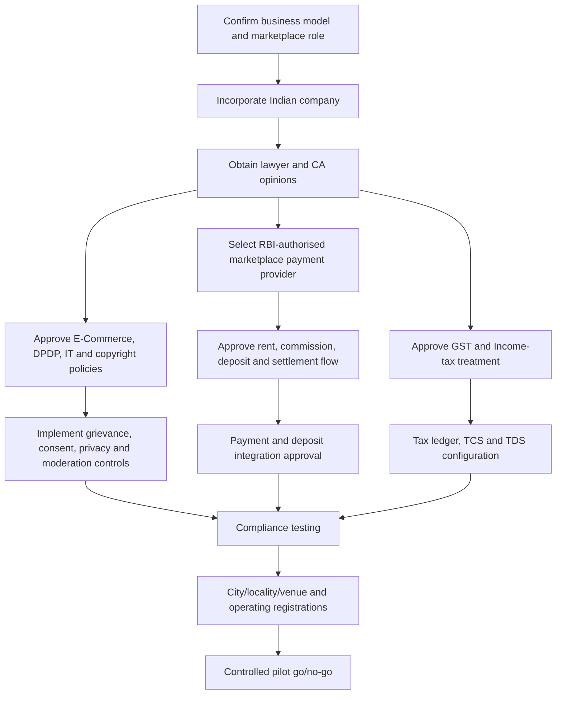

# Compliance Dependencies and Launch Gates — ShelfShare

**Research cut-off:** 30 October 2026  
**Purpose:** Translate the compliance research into product, vendor, finance and operations dependencies.  
**Status:** No dependency is approved or completed unless evidence is attached.

## 1. Critical path overview

## 2. Dependency register

| ID | Dependency | Owner / professional | Required before | Product / operational impact | Evidence to close |
|---|---|---|---|---|---|
| CD-001 | Confirm ShelfShare is marketplace e-commerce entity and company requirement | Indian e-commerce lawyer / CS | Incorporation and policy finalisation | Entity, contracts, public disclosures | Written legal memo |
| CD-002 | Incorporate Indian Private Limited Company and complete MCA filings | CS | Provider contracts, production operations | Contracting entity, GST, PAN/TAN, governance | COI, PAN, TAN, MCA filing set |
| CD-003 | Appoint resident nodal functionary and grievance officer | Company / lawyer | Public launch | Consumer complaint response | Appointment and public contact details |
| CD-004 | Confirm 2020 E-Commerce Rules and 2026 amendment obligations | Consumer-law lawyer | UX/policy freeze and before 1 Jan 2027 | Seller disclosures, grievance, NCH, ranking, ads, discounts | Legal compliance matrix |
| CD-005 | Review full G.S.R. 789(E) Gazette amendment | Lawyer | 2027 readiness | Exact implementation details | Signed amendment review |
| CD-006 | NCH partnership/convergence onboarding | Operations / grievance owner | 1 Jan 2027 readiness | Consumer complaint escalation | NCH onboarding record |
| CD-007 | Annual dark-pattern self-audit and certificate process | Product, UX, lawyer | 1 Jan 2027 readiness | Checkout, pricing, subscription and interface design | Audit report/certificate process |
| CD-008 | GST ECO registration opinion | CA | Any live supply/transaction | Registration, invoicing and returns | GST registration and CA memo |
| CD-009 | Book rental SAC/rate and public-library exemption analysis | CA / GST counsel | Before pricing and checkout | Tax display and settlement calculation | Written classification opinion |
| CD-010 | GST TCS applicability and 0.5% rate setup | CA | Before owner settlement | TCS calculation, GSTR-8 and ledger | CA-approved tax specification |
| CD-011 | Income-tax Act 2025 section 393 owner payout TDS | CA | Before owner payouts | Owner gross amount, withholding and certificates | Written TDS memo and test calculation |
| CD-012 | RBI-authorised PA provider selection | Finance / lawyer | Before payment integration | Customer collection, marketplace settlement | RBI status check and signed agreement |
| CD-013 | Provider approval for individual owner/sub-merchant onboarding | Payment provider | Before owner onboarding | KYC and payout destination | Written provider confirmation |
| CD-014 | Provider approval for split settlement and commission | Payment provider | Before live payments | 10% commission and owner payout | Product contract and test evidence |
| CD-015 | Deposit collection/hold/release legal model | Lawyer + PA + bank | Before deposit collection | Deposit status, dispute and refund | Written legal opinion and provider approval |
| CD-016 | No own wallet / no unlicensed PA architecture | Lawyer + architect + finance | Architecture approval | Ledger and funds flow | Funds-flow diagram and legal sign-off |
| CD-017 | DPDP Act/Rules phased commencement plan | Privacy counsel / DPO or owner | Before production data collection and May 2027 | Consent, notice, rights, breach and retention | DPDP gap assessment |
| CD-018 | Rule 4 and Act provisions effective 13 Nov 2026 | Privacy counsel | 13 Nov 2026 | Consent manager/related provisions as applicable | Commencement-specific action memo |
| CD-019 | Full substantive DPDP readiness by 13 May 2027 | Privacy/security | 13 May 2027 | Data fiduciary operations and rights | Readiness audit |
| CD-020 | Data inventory, privacy notice and processor agreements | Privacy counsel / security | Before collecting personal data | ID evidence, photos, location, chat and payment metadata | Approved documents |
| CD-021 | Identity document collection and retention design | Privacy counsel / verification provider | Before KYC feature launch | Private storage and deletion | Data flow and retention approval |
| CD-022 | Child/age gate method for 18+ platform | Lawyer / identity provider | Before transaction access | Age verification and child-data controls | Approved age-check policy |
| CD-023 | TRAI Principal Entity registration, headers and templates | SMS provider / operations | Before bulk OTP/service SMS | Authentication and notifications | PE registration and template approvals |
| CD-024 | IT Act intermediary/safe-harbour opinion | IT lawyer | Before user-generated content goes live | Listings, reviews, chat and community | Written opinion |
| CD-025 | Intermediary grievance and takedown workflow | Trust & Safety / lawyer | Before public UGC | Notice handling and evidence | SOP and test cases |
| CD-026 | Commercial physical-book rental copyright opinion | Copyright lawyer | Before commercial rentals | Whether P2P rental can operate and under what conditions | Written copyright opinion |
| CD-027 | Owner lawful-ownership declaration and prohibited-copy policy | Lawyer / product | Before listings | Listing contract and moderation | Approved owner terms |
| CD-028 | Telangana Shops & Establishments applicability | Telangana CS / local counsel | Hyderabad office/establishment | Registration and employee records | Registration or N/A opinion |
| CD-029 | Karnataka Shops & Commercial Establishments applicability | Karnataka CS / local counsel | Bengaluru office/establishment | Registration and employee records | Registration or N/A opinion |
| CD-030 | Municipal / premises / fire / local approvals | Local counsel / venue ops | Any physical premises/venue operation | Office and handover points | Permits or written N/A |
| CD-031 | NSWS Know Your Approvals review | CS / operations | Before launch | State/central approvals | Saved KYA output and verified list |
| CD-032 | ShelfShare trademark clearance and filing | Trademark agent | Public brand launch | Brand and app identity | Search report and clearance |
| CD-033 | Grievance and support operating model | Operations / lawyer | Pilot launch | Statutory response times and user support | SOP, staffing and SLA |
| CD-034 | Approved public handover points and venue contracts | Operations / local counsel | Pilot launch | Safe collection and return | Venue approval, terms and operating hours |
| CD-035 | Finance reconciliation and audit trail | CA / finance / engineering | Before first payout | PA reports, GST, TDS, refunds and owner statements | Reconciliation test and sign-off |

## 3. Provider dependency details

### 3.1 Payment aggregator
The selected provider must confirm:
- RBI authorisation status for relevant activity.
- Marketplace/sub-merchant use case acceptance.
- Owner onboarding and KYC requirements.
- Split settlement / platform fee deduction.
- Permitted settlement timing and hold periods.
- Refund, reversal, chargeback and failed payout flows.
- Deposit collection/hold/release functionality and legal account structure.
- Reconciliation exports and API/webhook documentation.
- Whether platform can initiate a dispute hold and under what contractual limits.

**Blocker:** A provider offering standard payment checkout is not automatically approved for marketplace payouts or deposit custody.

### 3.2 SMS provider
Must support Indian DLT onboarding and approved templates for OTP, service and transactional messages. Promotional communication consent must be separated from operational notices as required by the applicable framework.

### 3.3 Identity verification provider
Must support lawful purpose, consent, data minimisation, security, data retention/deletion, manual review escalation and current Indian legal requirements. Do not assume a provider can access any identity database or use Aadhaar-based authentication without specific authorisation and lawful basis.

### 3.4 Map and handover venue providers
Map display does not certify venue safety. ShelfShare must separately validate public access, opening hours, accessibility, location accuracy and venue permission. Do not display CCTV/security claims without evidence.

## 4. Release gates

### Gate 1 — Business and legal model
- CD-001 to CD-007 resolved.
- Company incorporated or approved incorporation plan.
- Marketplace roles and owner contracts approved.
- Full 2027 consumer amendment action plan approved.

### Gate 2 — Money movement
- CD-008 to CD-016 resolved.
- PA provider contract signed.
- GST/TCS/TDS treatment signed off by CA.
- Deposit feature remains disabled until CD-015 is closed.

### Gate 3 — Data and platform governance
- CD-017 to CD-027 resolved or safely disabled.
- Privacy notice and data inventory approved.
- Identity evidence storage, access and retention controls tested.
- Intermediary complaint/takedown process operational.
- Copyright opinion received.

### Gate 4 — State and operational readiness
- CD-028 to CD-035 closed or documented N/A.
- Support staffing and grievance SLA ready.
- Public handover points validated.
- Tax and payment reconciliation tested.

### Gate 5 — Controlled pilot
- No unresolved P0 legal or payment blockers.
- No deposits collected without provider/legal approval.
- Owner payouts use approved provider settlement.
- Complaints, disputes, refunds, privacy requests and safety incidents have named owners.
- Pilot metrics and escalation thresholds approved.

## 5. Safe feature toggles while dependencies remain open

| Feature | If dependency remains open | Safe interim behaviour |
|---|---|---|
| Security deposit | Provider/legal custody not approved | Disable deposit collection and deposit balance UI; do not show fake wallet/escrow |
| Owner payouts | PA marketplace flow not approved | Do not accept paid bookings or show earnings as withdrawable |
| GST/TDS | CA tax treatment not approved | Do not process live marketplace transactions; do not invent tax rates |
| Identity document upload | Privacy/retention model not approved | Keep transaction access disabled; do not collect sensitive IDs prematurely |
| Community/chat | IT/intermediary moderation not staffed | Keep community/chat disabled or limited to tested, moderated pilot |
| Sponsored listings/promotions | 2027 disclosure and price-history controls not ready | Do not sell sponsored placement or announce discounts |
| Book rental | Copyright opinion pending | Do not launch commercial rentals until counsel signs off |
| New city/locality | Venue and state approval not validated | Keep city/locality disabled in booking configuration |

## 6. Change monitoring

Re-check the following at least before launch and whenever legal changes are announced:
- Consumer Protection (E-Commerce) Rules and CCPA notifications.
- GST rates, section 52 notifications, GST Council recommendations and GST portal forms.
- Income-tax Act 2025, Finance Acts, CBDT circulars and TDS tables.
- RBI PA directions, authorised PA list and payment provider terms.
- DPDP Act/Rules commencement notifications and Board directions.
- TRAI TCCCPR directions and access-provider Codes of Practice.
- IT Act / Intermediary Rules amendments and court directions.
- Copyright Act amendments and relevant court decisions.
- State Labour Department and municipal requirements.
- IP India trademark registry and opposition/examination status.

**Ownership:** Assign a named legal/compliance owner to maintain a dated change log. Do not rely on a one-time research snapshot for ongoing compliance.
