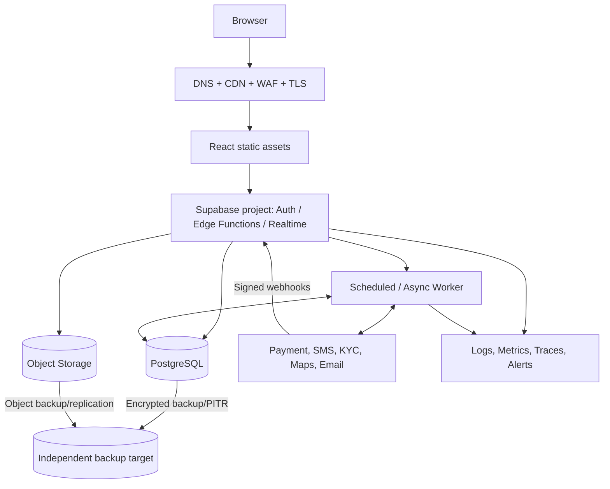

# Deployment Architecture — ShelfShare

## 1. Environments

Maintain isolated:
- Local development.
- Shared development/integration.
- Staging/pre-production.
- Production.

Each has separate Supabase project/database, storage buckets, Auth config, SMS sender/template environment, KYC sandbox/live credentials, payment sandbox/live credentials, webhook secrets, maps keys and monitoring projects. No production PII copied into development. Use synthetic or irreversibly masked test data.

## 2. Infrastructure topology

## 3. Hosting selection

Frontend hosting candidates: Vercel, Cloudflare Pages or equivalent. Evaluate:
- latency for Hyderabad/Bengaluru;
- custom domain/TLS/WAF;
- security headers and CSP;
- preview deployment access controls;
- build reproducibility;
- log retention and privacy;
- region/data processing;
- support, cost and rollback.

Supabase region must be selected based on available India-region options, latency, contractual processing, backup and feature availability. Confirm region before production project creation; region migration may be costly.

## 4. CI/CD pipeline

```mermaid
flowchart LR
  Commit[Feature branch commit]
  PR[Pull request]
  Checks[Lint + typecheck + unit tests]
  Security[SAST + dependency + secret scan]
  DBCheck[Migration lint + local DB tests + RLS tests]
  Build[Frontend and function build]
  Review[Code review / approval]
  Stage[Deploy staging]
  E2E[Integration + Playwright E2E]
  Approve[Release approval]
  Prod[Production deploy]
  Verify[Smoke tests + monitor]
  Commit --> PR --> Checks --> Security --> DBCheck --> Build --> Review --> Stage --> E2E --> Approve --> Prod --> Verify
```

- Protect `main`; require PR and review.
- Run database migrations in CI against ephemeral/local PostgreSQL.
- Verify RLS and exclusion constraints in tests.
- Deploy staging automatically after merge.
- Production requires approval and release notes.
- Use backward-compatible expand/migrate/contract schema changes.
- Never place secrets in build-time public variables.
- Rollback app version quickly; database rollback uses forward fix/compensating migration where destructive reversal is unsafe.

## 5. Database migrations

- Store ordered SQL migrations in Git.
- Generate typed client schema after migration.
- Apply to local and staging first.
- Check lock duration and table rewrite impact.
- Use additive changes before switching code.
- Use feature flags for incomplete workflows.
- Record applied migration version and deployment ID.
- No manual production schema edits except emergency documented change followed by migration reconciliation.

## 6. Secrets and configuration

Use platform secret manager for service credentials. Separate sandbox and production credentials. Rotate keys and webhook secrets. Public browser variables may contain only anon/public keys and non-sensitive map configuration; RLS must protect data. Never commit `.env`, service-role key, provider secret, signing key or private KYC credentials.

## 7. Backup and disaster recovery

- Confirm Supabase plan's backup frequency, retention and PITR eligibility before launch.
- Independent encrypted database export to a separate account/provider.
- Object storage backup/replication must be explicitly designed; do not assume DB backup includes binary objects.
- Back up schema migrations, RLS policies, edge function source, configuration manifests, legal/policy versions and operational runbooks.
- Define RPO/RTO with business owner (currently OPEN DECISIONS).
- Test full restore quarterly at minimum or agreed cadence.
- Restore order: infrastructure/config → database schema/data → object storage → auth/config reconciliation → provider webhook replay/reconciliation → smoke tests.
- Validate financial journal balance, reservation uniqueness, booking states, evidence references and notification outbox after restore.
- Maintain provider settlement reports outside primary platform account to reconcile after recovery.

## 8. Scaling and performance

Initial scale:
- PostgreSQL connection pooling.
- Index booking state/due date/copy ID and common discovery filters.
- Paginate all lists.
- Use materialised views for admin analytics.
- Use CDN for public images.
- Background processing for image transformations and notifications.
- Monitor lock contention around hot copies and booking exclusion checks.

Scale triggers (measure, do not assume):
- Move long-running workers to managed queue/container service if Edge Function limits/throughput require.
- Introduce search service if Postgres relevance/latency fails SLO.
- Separate analytics warehouse when OLTP/reporting contention appears.
- Split service only for independent scaling, team ownership or compliance isolation.

## 9. Operational readiness

Before launch:
- provider sandbox and live account approval;
- test webhook delivery and reconciliation;
- verify DLT template/sender setup;
- KYC review queue and support staffing;
- backup restore drill;
- security assessment and penetration test;
- incident response exercises;
- payment/refund/payout failure runbooks;
- admin training;
- monitoring alerts and on-call ownership;
- legal/CA sign-off for policies and money movement.

## 10. SLO and recovery decisions

Availability target, API latency target, RPO, RTO, support coverage, backup retention and alert response times are not approved in PRD. Product/operations must set them before production. Do not advertise vendor SLAs as ShelfShare's own until the complete architecture has been tested.
