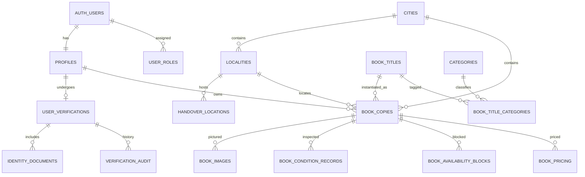
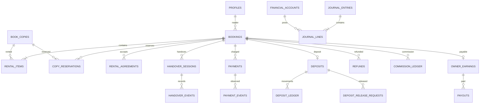
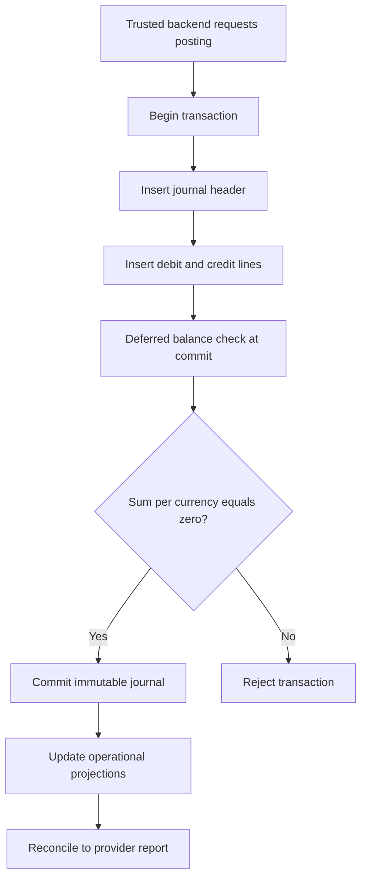

# ShelfShare — Entity Relationship Diagrams

The diagrams show logical relationships. Some one-to-many relationships are omitted from the overview to keep it readable; the migrations define the complete model.

## 1. Identity, geography and inventory



## 2. Booking, reservations, handover and finance



## 3. Trust, community and operations

```mermaid
erDiagram
  BOOKINGS ||--o{ DISPUTES : contested
  DISPUTES ||--o{ DISPUTE_EVIDENCE : supported
  BOOKINGS ||--o{ CHAT_CONVERSATIONS : contextual
  CHAT_CONVERSATIONS ||--o{ CHAT_PARTICIPANTS : includes
  CHAT_CONVERSATIONS ||--o{ CHAT_MESSAGES : contains
  PROFILES ||--o{ USER_REPORTS : files
  PROFILES ||--o{ USER_BLOCKS : blocks
  RENTAL_ITEMS ||--o{ REVIEWS : reviewed
  PROFILES ||--o{ REFERRALS : refers
  REFERRALS ||--o{ REFERRAL_REWARDS : rewards
  PROFILES ||--o{ COMMUNITY_POSTS : authors
  COMMUNITY_POSTS ||--o{ COMMUNITY_COMMENTS : receives
  PROFILES ||--o{ READING_LISTS : creates
  READING_LISTS ||--o{ READING_LIST_ITEMS : contains
  CHALLENGES ||--o{ CHALLENGE_PARTICIPANTS : includes
  PROFILES ||--o{ BOOK_EXCHANGE_REQUESTS : requests
  BOOK_EXCHANGE_REQUESTS ||--o| EXCHANGE_TRANSACTIONS : accepted_as
  PROFILES ||--o{ NOTIFICATIONS : receives
  PROFILES ||--o{ GRIEVANCE_TICKETS : opens
  PROFILES ||--o{ PRIVACY_REQUESTS : submits
  LEGAL_DOCUMENTS ||--o{ LEGAL_ACCEPTANCES : accepted
  PROFILES ||--o{ ADMIN_AUDIT_LOGS : actor
  PROFILES ||--o{ RISK_ALERTS : subject
```



## 4. Critical booking reservation constraint

```mermaid
flowchart TD
  A[Reader submits booking request] --> B[Backend begins transaction]
  B --> C[Lock and validate copy, users, city and policy]
  C --> D[Insert booking and rental item]
  D --> E[Insert copy reservation with [start,end) range]
  E --> F{Exclusion constraint passes?}
  F -- Yes --> G[Commit and return pending booking]
  F -- No --> H[Rollback; return slot unavailable]
  G --> I[Create payment attempt in separate trusted step]
```

The exclusion constraint on `(copy_id WITH =, reserved_period WITH &&)` is the final guard against concurrent overlapping reservations. Availability reads are never a lock.

## 5. Critical financial journal constraint


